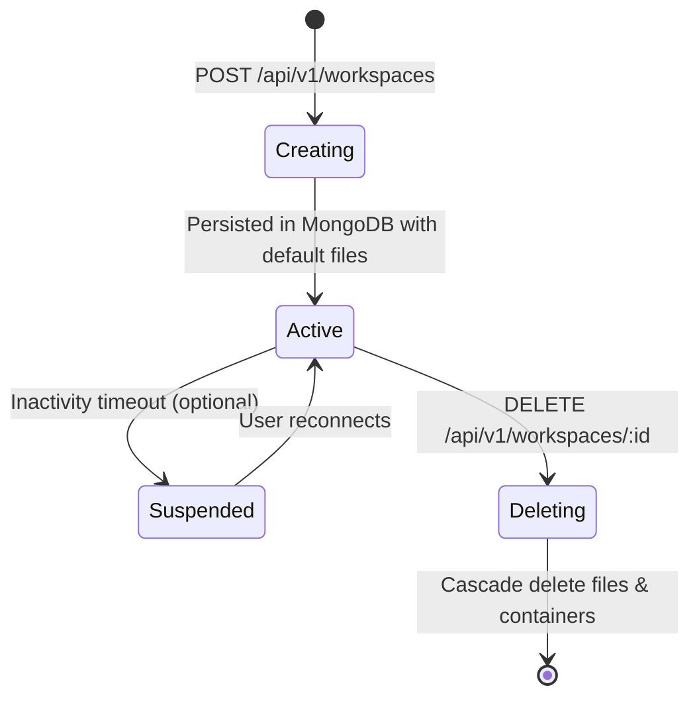
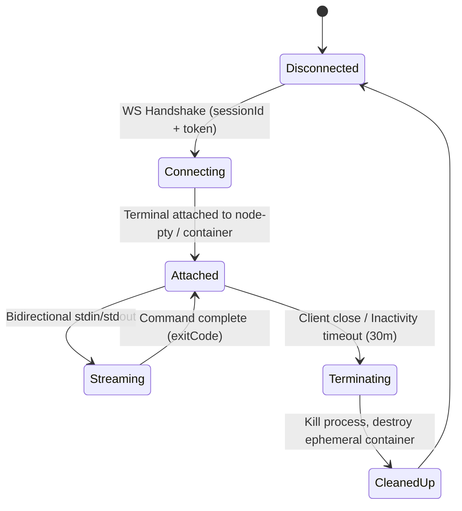

# Architecture Overview & Cross-Module Integration Map

**Project:** Zaalima Project 2 — Distributed Cloud IDE & Sandboxed Code Execution Platform  
**Document ID:** ARCH-MAP-001  
**Author:** Saransh (Team Lead / Integration)  
**Status:** Approved for Implementation (Phase 0 Baseline)  
**Last Updated:** 2026-11-23

---

## 1. Executive Summary & System Boundaries

The Zaalima Cloud IDE is a distributed browser-based engineering platform providing browser-based code editing, real-time interactive terminal access, isolated containerized execution, and multi-user collaborative synchronization.

The system is partitioned into four decoupled modules with strict interface contracts:

```text
┌────────────────────────────────────────────────────────────────────────┐
│                        1. Frontend Layer (`apps/web`)                  │
│                             Owner: Swathi                              │
│                                                                        │
│   ┌─────────────────────┐  ┌────────────────────┐  ┌────────────────┐  │
│   │    Monaco Editor    │  │  xterm.js Terminal │  │ File Explorer  │  │
│   └──────────┬──────────┘  └─────────┬──────────┘  └───────┬────────┘  │
│              │                       │                     │           │
│              │ State Management & WebSocket Client         │           │
└──────────────┼───────────────────────┼─────────────────────┼───────────┘
               │                       │                     │
               │ HTTP REST             │ WSS (WebSockets)    │ HTTP REST
               ▼                       ▼                     ▼
┌────────────────────────────────────────────────────────────────────────┐
│                   2. Backend & API Layer (`apps/api`)                  │
│                             Owner: Nikhil                              │
│                                                                        │
│   ┌────────────────────────────────────────────────────────────────┐   │
│   │  Middleware: Request Logger | Central Error Handling | Auth    │   │
│   └────────────────────────────────┬───────────────────────────────┘   │
│                                    │                                   │
│   ┌─────────────────────┐  ┌───────▼────────────┐  ┌────────────────┐  │
│   │ Workspace Controller│  │ File Tree Manager  │  │ Health Service │  │
│   └──────────┬──────────┘  └─────────┬──────────┘  └───────┬────────┘  │
│              │                       │                     │           │
│              ▼                       ▼                     ▼           │
│   ┌────────────────────────────────────────────────────────────────┐   │
│   │              Mongoose ODM & Persistence Boundary               │   │
│   └────────────────────────────────┬───────────────────────────────┘   │
└────────────────────────────────────┼───────────────────────────────────┘
                                     │
                                     ▼
                      ┌─────────────────────────────┐
                      │    MongoDB Data Store       │
                      │  Users | Workspaces | Files │
                      └─────────────────────────────┘
                                     │
                                     │ Job Dispatch / PTY Bridge
                                     ▼
┌────────────────────────────────────────────────────────────────────────┐
│              3. Sandboxed Execution Engine (`services/execution`)      │
│                             Owner: Mahak                               │
│                                                                        │
│   ┌───────────────────┐    ┌───────────────────────────────────────┐   │
│   │   Docker Engine   │    │          Host Level Isolation         │   │
│   │        API        │───▶│  - Linux Namespaces (pid, net, ipc)   │   │
│   └─────────┬─────────┘    │  - cgroups v2 (CPU/Memory/IO caps)    │   │
│             │              │  - seccomp security profile           │   │
│             ▼              │  - Ephemeral tmpfs & RO rootfs        │   │
│   ┌───────────────────┐    └───────────────────────────────────────┘   │
│   │      node-pty     │                                                │
│   │  Pseudo-Terminal  │───────────────────────────┐                    │
│   └───────────────────┘                           │                    │
└───────────────────────────────────────────────────┼────────────────────┘
                                                    ▼
                                     WebSockets to xterm.js
```

---

## 2. Module Ownership & Interface Boundaries

| Module / Scope | Primary Owner | Inbound Interface | Outbound Interface | Storage / State |
| :--- | :--- | :--- | :--- | :--- |
| **Frontend UI** (`apps/web`) | **Swathi** | User interactions, WebSocket frames from API | REST API calls, WebSocket client messages | In-memory React state, Monaco buffers |
| **Backend APIs** (`apps/api`) | **Nikhil** | REST HTTP requests from Web, WS connections | MongoDB queries, PTY/Sandbox IPC | MongoDB database (`cloud_ide`) |
| **Sandbox Runtime** (`services/execution`) | **Mahak** | Spawn/exec requests from Backend / WS bridge | Raw stdout/stderr streams, exit status | Ephemeral Docker containers, tmpfs scratchpads |
| **Integration & Release** | **Saransh** | PR reviews, cross-module contracts, CI | Shared npm package (`@cloud-ide/shared`), docs | Monorepo configuration, deployment topology |

---

## 3. Core Lifecycle State Machines

### 3.1 Workspace Lifecycle


### 3.2 Terminal & Execution Session Lifecycle


---

## 4. End-to-End Vertical Integration Path

The core operational flow across all four modules follows this validated sequence:

1. **Workspace Initiation:**
   - User creates or selects a workspace in `apps/web`.
   - Backend `apps/api` validates request via `validateCreateWorkspaceDTO`.
   - Workspace record and initial root directory are persisted in MongoDB.
2. **File Tree Population & Editor Load:**
   - `apps/web` fetches file metadata tree via `GET /api/v1/workspaces/:id/files`.
   - Monaco Editor loads active file buffer based on tab selection.
3. **Execution / Terminal Bridge:**
   - User requests terminal session or code execution.
   - `apps/web` initiates WebSocket connection to `/ws/terminal?workspaceId=...`.
   - `apps/api` authenticates connection and dispatches spawn request to `services/execution`.
   - `services/execution` provisions an isolated Docker container with resource caps (512MB RAM, 1.0 vCPU, non-root user).
   - Stdin/stdout streams are piped in real time between `xterm.js` and the container PTY.
4. **Session Termination & Cleanup:**
   - Upon process exit or client disconnection, `services/execution` forces cleanup of ephemeral containers and unlinks scratch volumes.
