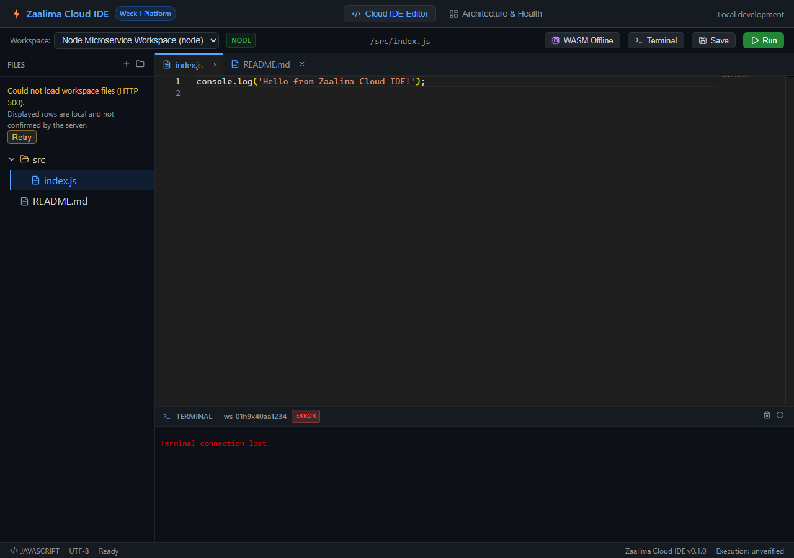
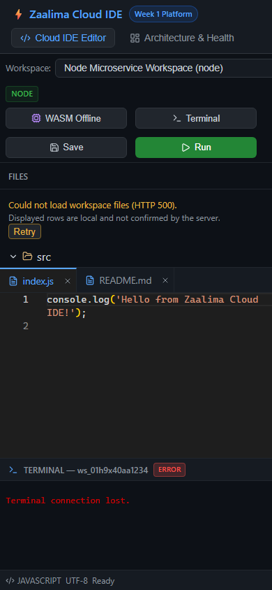

# Frontend QA — 24 November 2026

## Scope and pre-work

- **Member:** Swathi — Frontend / IDE Experience
- **Work mode:** OpenAI Codex, selected earlier in this setup session
- **Branch:** `swathi`
- **Repository:** `https://github.com/SLBytes15/cloud-ide-sandbox-platform.git` (verified origin)
- **Starting commit:** `54477fd` (`origin/main`)
- **Working tree before QA:** clean
- **Branch synchronization:** local `swathi` is at `origin/main`; it is 12 commits ahead of the stale `origin/swathi`. No push or commit was made.
- **Conflicts:** none
- **Environment:** Node `v26.13.0`, npm `11.20.0`, Windows, frontend dev server at `http://localhost:5173/`.
- **Services:** API port 5001 was not listening; Vite reported refused API/WebSocket proxy connections. MongoDB and Docker executables were unavailable. Backend-dependent flows are not verified.

Yesterday's setup work was rechecked: the official origin is correct, the own branch is `swathi`, the shared package builds, and the frontend starts. The API and database were not started as part of this frontend-owned pass.

## Findings and evidence

| Area / severity | Before and reproduction | Result and evidence | Follow-up / limitation |
|---|---|---|---|
| Monaco model isolation — **P1, fixed** | The editor model path used only the file path. Open the same path in two workspaces and Monaco could reuse one model. | Monaco paths now include the workspace ID. A Node test verifies identical file paths produce distinct model paths. Local Monaco workers and configured language registrations now let the editor render without downloading Monaco from a CDN, following the [React wrapper's Vite setup](https://github.com/suren-atoyan/monaco-react#use-monaco-editor-as-an-npm-package) and [Monaco's ESM registration guidance](https://github.com/microsoft/monaco-editor/blob/main/CHANGELOG.md). | Browser image confirms initial editor rendering and JavaScript highlighting. Tab editing, close/reopen, model disposal, language-by-language highlighting, and large-file behavior were not manually exercised. |
| Workspace state and request races — **P1, fixed** | File buffers, tabs, and active path were global. Switching workspaces could expose stale state; a late file response could overwrite the current workspace view. | Editor snapshots are keyed by workspace ID. A completed request updates only its workspace; cancelled effects ignore late responses. Dirty buffers are retained when server file data refreshes, clean tabs absent from the loaded file list are removed, and the active tab is repaired. Tests cover same-path isolation and dirty-buffer retention. | The state logic is unit-tested; rapid workspace switching against a live API was not tested because the API was unavailable. |
| File-tree loading/error and keyboard use — **P2, fixed in frontend** | File requests failed silently, and clickable file/folder rows were non-keyboard `div`s. | File rows and folder toggles are native buttons, folders expose expanded state, create/delete controls and inputs have accessible names, and loading/error/retry/empty states are present. The browser screenshot shows the API failure and retry control instead of implying data loaded. A pure helper test verifies nested removal. | Keyboard-only operation, screen-reader announcements, deep-tree behavior, long names, and large-list performance were not manually tested. The tree is recursive and not virtualized. Create/delete remain local-only. |
| Terminal routing and lifecycle — **P1, frontend fix; integration blocked** | The terminal connected to the page host but Vite had no WebSocket proxy. Old socket close callbacks could overwrite a newer connection status, and errors showed an offline preview prompt. | Vite now proxies `/ws` to the documented local API port. Terminal status covers connecting, reconnecting, connected, disconnected, error, and cleanly closed states; stale socket callbacks are ignored. Resize uses both window resize and `ResizeObserver`; cleanup closes the socket and disposes xterm. Offline Enter now says the command was not sent. Tests cover socket URL and status transitions. | API unavailable, so no real handshake, input/output, resize, reconnect, cleanup-on-workspace-switch, or rapid/long output test was possible. The browser shows `ERROR`/connection lost while API is down. `TerminalOutputPayload` has no stdout/stderr field; `ExecutionChunkPayload` does, but the terminal bridge uses a different event. Do not infer stream type in the frontend; coordinate with API/runtime owners before changing the shared event contract. |
| Save/create/delete messaging — **P1, misleading success removed** | Save previously cleared the dirty marker and displayed “Saved” despite only changing in-memory state. Create/delete also changed local state only. | Save now keeps the dirty marker and says the file was not saved. Create/delete status says the operation remained in local editor state. Execution network failure no longer says it was simulated. | File persistence and mutations are not wired from the frontend. Coordinate with the backend owner on the documented workspace/file routes and file-ID mapping before implementing persistence. No backend or shared-contract files were changed. |
| Responsive layout and status claims — **P2, fixed in frontend** | The toolbar clipped controls at a narrow viewport; the IDE footer and dashboard implied sandbox readiness/features without live verification. | Toolbar controls fit in a two-column layout at 390 px. Workspace select, toolbar controls, tabs, tree controls, terminal actions, status messages, and alerts have labels or status semantics. Footer now says execution is unverified; dashboard cards describe repository areas rather than showing static green checks. | Screenshots were inspected at 1280×900 and 390×844. Keyboard-only interactions and formal color-contrast measurements were not run. |
| Bundle size — **P2, known limitation** | Local Monaco integration adds editor/language code to the web build. | Production build succeeds. The main JavaScript entry is about 4.74 MB raw (1.24 MB gzip); the TypeScript worker is about 7.09 MB raw. Vite warns about chunks over 500 kB. | Consider a reviewed editor feature/language selection and code-splitting pass. No plugin or new package was added; `monaco-editor@0.58.0` was already in the lockfile and is now declared directly because the frontend imports it. |

## Browser evidence

Headless Chrome rendered the initial IDE at both viewports. The screenshots intentionally show the unavailable API and terminal error states from this machine.

## End-to-end journey status

| Step | Status | Evidence / reason |
|---|---|---|
| Open IDE | **VERIFIED** | Headless Chrome rendered the IDE and local Monaco editor in both screenshots. |
| Load workspace list/files | **PARTIAL** | The frontend request path and visible error/retry state were exercised; API returned HTTP 500 because port 5001 was unavailable. Sample workspace data remains visible and is identified as not loaded. |
| Browse/edit/close file tabs | **PARTIAL** | Initial editor and two tabs rendered; state helpers are tested. User-driven edit/switch/close flows were not automated. |
| Save/persist | **NOT IMPLEMENTED in frontend** | UI now reports that save was not persisted; the API was unavailable. |
| Execute code | **BLOCKED** | API/execution service was unavailable; no result was claimed. |
| Terminal input/output/resize/reconnect | **BLOCKED** | WebSocket proxy configuration is present, but the API did not accept connections. |
| Stop/timeout/cleanup and collaboration | **NOT TESTED** | Requires live backend/runtime or collaboration peers; no such services were running. |

## Commands and results

| Command/check | Result |
|---|---|
| `npm.cmd install --package-lock-only --ignore-scripts --offline --workspace=@cloud-ide/web` | **PASS** — lockfile recognizes the direct `monaco-editor@^0.58.0` dependency; audit found 0 vulnerabilities. |
| `npm.cmd test --workspace=@cloud-ide/web` | **PASS** — 6 tests, 0 failures. Tests cover workspace isolation, Monaco model paths, dirty buffers, nested tree removal, WebSocket URL, and terminal status transitions. |
| `npm.cmd run typecheck --workspace=@cloud-ide/web` | **PASS** |
| `npm.cmd run build --workspace=@cloud-ide/web` | **PASS** — Vite 6.4.6; large-chunk warning recorded above. |
| Frontend lint | **NOT RUN** — no lint script exists in `apps/web/package.json`. |
| Browser layout | **PASS for rendered screenshots** — Chrome headless at 1280×900 and 390×844. Interaction and console-log checks were not run. |
| API/WebSocket connectivity | **BLOCKED** — API port 5001 was not listening; Vite logged `ECONNREFUSED`. |
| `git diff --check` | **PASS** — run after the final source and report changes. |

## Coordination items and handoff

1. **Frontend ↔ backend:** agree how the frontend maps file paths to file IDs for the documented file update route and how create/delete responses update the tree. Owner: Swathi with the backend owner; no contract change made.
2. **Terminal event contract:** terminal output currently has no stdout/stderr discriminator. Coordinate with backend/runtime owners before exposing stream distinctions. No shared DTO or backend code was changed.
3. **Performance:** review Monaco feature/language chunking because of the build size warning. No dependency upgrade or plugin was introduced.
4. **Release evidence limits:** no MongoDB, Docker runtime, live API, multi-peer collaboration, or full interactive test harness was available. No claims are made for those flows.

**Approval requests:** none posted; this pass stayed within frontend files and existing contracts.
**Commit / push:** none. Swathi will review, stage, commit, and push manually.
