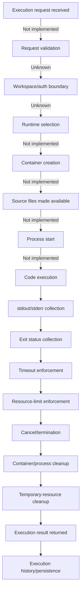

# Sandbox Runtime Audit

Date: 22 November 2026  
Scope: Execution-runtime scaffold audit, runtime lifecycle analysis, Docker/Linux sandbox research, and documentation.

## 1. Repository and branch verification

- Repository root: `C:\Users\Mahak\Documents\GitHub\Zaalima_Project2\cloud-ide-sandbox-platform`
- Remote: `https://github.com/SLBytes15/cloud-ide-sandbox-platform.git`
- Current branch: `mahak`
- Current commit: `209df59dc905a490a106e1127fd542a6d0277f04`
- Remote branches observed: `origin/main`, `origin/mahak`, `origin/nithin`, `origin/saransh`, `origin/swathi`
- Working tree: clean at audit start; no modified or untracked files
- Branch rule: satisfied. The repository was not switched, synchronized, committed, pushed, merged, reset, stashed, or rebased.

## 2. Execution service structure

`services/execution/` contains only `README.md`. There is no package manifest, TypeScript source, TypeScript configuration, build script, test directory, Dockerfile, Compose file, or lockfile specific to the service.

The README describes a future execution engine and is documentation/planning evidence only. It proposes Docker Engine API integration, `node-pty`, Linux namespaces, cgroups v2, seccomp, read-only root filesystems, and disabled egress.

## 3. Existing implementation status

| Area | Status | Evidence |
|---|---|---|
| Execution files/directories | **Documentation only** | Only `services/execution/README.md` exists |
| Executable execution code | **Missing** | No source files under `services/execution/` |
| Service package configuration | **Missing** | No `services/execution/package.json` |
| TypeScript configuration | **Missing** | No `services/execution/tsconfig.json` |
| Build script | **Missing** | Root package scripts build only workspaces that contain build scripts |
| Test script | **Missing** | No execution test or test script found |
| Docker dependency | **Missing** | No Docker client library such as Dockerode is declared |
| Docker configuration | **Missing** | No Dockerfile or Compose configuration found |
| Docker Engine API integration | **Missing** | No API client or lifecycle calls exist |
| Docker CLI integration | **Missing** | No CLI invocation or wrapper exists |
| Process execution code | **Missing** | No runtime process implementation exists |
| `node-pty` integration | **Missing** | No dependency or source integration exists |
| Container lifecycle logic | **Missing** | No create/start/stop/remove implementation exists |
| Timeout logic | **Missing** | No execution timeout implementation exists |
| Resource-limit logic | **Missing** | No CPU, memory, PID, or disk limit implementation exists |
| Cleanup logic | **Missing** | No container or temporary-resource cleanup implementation exists |
| Security restrictions | **Planned/documented** | Security and architecture documents describe intended controls |
| Backend integration | **Missing** | API currently exposes health endpoints only |
| Execution-job persistence | **Proposed only** | `ExecutionJob` exists as a shared type and MongoDB schema is proposed |
| Execution interfaces/contracts | **Partial** | Shared execution types and WebSocket event names exist |
| Frontend terminal implementation | **Not implemented** | Frontend has a ready-state card/stub, not an execution or terminal client |

### Dependency summary

The root npm workspace covers `packages/*`, `apps/*`, and `services/*`, but no execution package is registered as a package implementation. Package dependencies do not include Dockerode, Docker SDK packages, `node-pty`, or WebSocket server packages in the execution service. The API has Express, Mongoose, CORS, dotenv, and TypeScript tooling; the shared package contains execution DTO types and WebSocket event names.

## 4. Repository integration evidence

- The API only mounts health routes: `apps/api/src/routes/index.ts`
- `apps/api/src/server.ts` provides HTTP startup and database shutdown handling, but no runtime shutdown or container cleanup.
- `packages/shared/src/types/execution.ts` defines `ExecutionJob`, `ExecutionRequest`, and execution statuses.
- `packages/shared/src/events/websocket.ts` defines terminal and execution event names.
- `docs/DATABASE_SCHEMA.md` proposes an `execution_jobs` collection, but no Mongoose execution model exists.
- `docs/ARCHITECTURE.md` presents the execution service and Docker/node-pty boundaries as future architecture.
- `docs/SECURITY.md` describes intended namespace, cgroup, seccomp, filesystem, network, capability, and timeout controls.
- ADR-004 approves decoupling the execution service from initial setup and explicitly defers Docker implementation.

No authorization, workspace ownership, file-mount, runtime-selection, queue, or execution API implementation is verified.

## 5. Docker availability verification

Exact command:

```powershell
docker --version
docker info --format '{{json .ServerVersion}}'
```

Result: Docker is not recognized by the PowerShell environment. The command failed with `CommandNotFoundException`, so Docker CLI availability and daemon accessibility are not verified. No containers were created, images pulled, commands executed, or Docker configuration changed.

## 6. Current runtime lifecycle



### Lifecycle implementation-status matrix

| Stage | Classification | Evidence |
|---|---|---|
| 1. Execution request received | **Not implemented** | No execution route or WebSocket handler |
| 2. Request validation | **Not implemented** | Shared request type exists, but no validator or endpoint |
| 3. Workspace/authorization boundary | **Unknown** | Security docs describe planned JWT/workspace authorization; no verified implementation |
| 4. Runtime selection | **Not implemented** | Runtime is proposed in the database schema, but no selection logic exists |
| 5. Container creation | **Not implemented** | No Docker API or CLI integration |
| 6. Workspace/source files made available | **Not implemented** | No mount-copy-snapshot implementation |
| 7. Process start | **Not implemented** | No Docker or local process implementation |
| 8. Code execution | **Not implemented** | No runtime worker |
| 9. stdout collection | **Not implemented** | WebSocket event is declared, but no streaming implementation |
| 10. stderr collection | **Not implemented** | No stderr handling |
| 11. Exit status collection | **Not implemented** | Shared type declares exit code, but no collector exists |
| 12. Timeout enforcement | **Not implemented** | Timeout values appear only in documentation |
| 13. Resource-limit enforcement | **Not implemented** | Limits appear only in documentation |
| 14. Cancellation/termination | **Not implemented** | No cancellation route or signal logic |
| 15. Container/process cleanup | **Not implemented** | No lifecycle cleanup logic |
| 16. Temporary-resource cleanup | **Not implemented** | No temporary storage implementation |
| 17. Execution result returned | **Not implemented** | No result endpoint or WebSocket flow |
| 18. Execution history/persistence | **Documented/proposed only** | Proposed schema and shared type; no implementation |

## 7. Official requirement mapping

| Requirement | Repository state | Gap |
|---|---|---|
| Week 1: Node.js container lifecycle manager using Docker Engine API | Not implemented | Need approved service boundary, Docker API client, lifecycle methods, authorization, validation, and tests |
| Week 2: frontend xterm.js to backend node-pty over persistent WebSockets | Not implemented | Frontend and backend need approved WebSocket protocol, node-pty process model, resize/input/output handling |
| Week 2: bidirectional stdin/stdout/stderr | Not implemented | No PTY or stream implementation |
| Week 2: Linux cgroups, namespaces, seccomp limits | Documented only | Need platform support validation and approved profiles/limits |
| Week 4: security audits for escape and lateral traversal | Not implemented | Need threat model, hardening baseline, approved test plan, and executed audit evidence |

## 8. Docker and Linux security research

### Docker Engine API

The Docker Engine API is a REST API exposed through the Docker daemon. It supports version negotiation and SDK or direct HTTP access. Container lifecycle operations include create, inspect, start, stop, wait, logs/stats, and remove. Container configuration is submitted during creation and can include resource limits, mounts, network mode, user, capabilities, security options, restart policy, and environment values.

The Docker CLI is a user-facing client that translates commands into Engine API calls. It is not a replacement for daemon security. Only trusted processes should control the daemon: control of the Docker socket can effectively provide powerful host access, and bind mounts or privileged configuration can expose or modify host files.

### Linux namespaces

Linux namespaces make a global resource appear as separate instances to processes in a namespace.

- **PID:** limits visibility of and signals to processes outside the namespace.
- **Mount:** isolates mount trees and bind mounts.
- **Network:** isolates interfaces, routes, sockets, and ports.
- **User:** maps container and host identities separately; user namespaces reduce privilege but require correct subordinate-ID configuration.
- **IPC:** isolates System V IPC and POSIX message queues.
- **UTS:** isolates hostname and NIS domain.

Namespaces improve isolation but do not protect against kernel vulnerabilities, shared-credential mistakes, dangerous daemon configuration, host mounts, or network access that is deliberately permitted.

### cgroups

cgroups organize processes and enforce CPU, memory, I/O, and process-count controls. cgroup v2 uses a unified hierarchy and controllers. Docker can expose CPU, memory, swap, PIDs, and block-I/O controls. They provide resource accounting and denial-of-service protection, but limits do not fix application bugs or all kernel-side attacks. cgroup v2 availability and controller support vary by host and deployment. PIDs limits can help stop fork bombs; memory limits can trigger OOM behavior; process and output limits are still required.

### seccomp

seccomp filters syscalls from processes. Docker's built-in profile is an allowlist and blocks a set of dangerous or unnecessary syscalls. It is a compatibility-friendly baseline, not a custom application profile. Custom profiles must account for the runtime, language tooling, PTY behavior, and future container features. Filtering alone cannot mitigate every vulnerability.

### Filesystem and privileges

Docker supports read-only root filesystems, read-only bind mounts, writable `tmpfs` for ephemeral directories, and explicit volume mounts. Bind mounts grant access to host paths and can be writable by default. Root in a container is not the same as unrestricted host root, but privileged containers, host mounts, excessive capabilities, and a control socket can erase that distinction.

The baseline for untrusted code should avoid privileged mode, drop unnecessary capabilities, run as an unprivileged user, and avoid mounting host roots or Docker data paths.

### Network isolation

Container network modes include none/disconnected execution, bridge/internal networks, host networking, and custom segmentation. Default bridge networking can still provide access to external networks and internal Docker networks unless restricted. Host-network mode removes a network namespace boundary and should be avoided for untrusted code. DNS and internal service reachability can enable SSRF and lateral movement.

No internal network policy is approved for this platform. Internet access, metadata access, DNS, container-to-container communication, host-service access, and egress filtering all require explicit decisions.

### Execution lifecycle security

Security controls must cover wall-clock timeout, inactivity timeout, cancellation, signal handling, process reaping, container removal, temporary-resource removal, orphan recovery after crashes, bounded output, disk limits, and recovery after daemon or worker restart. Docker `--rm` or API removal can help, but it should not be the only cleanup mechanism because crashes and lease expiry can leave orphaned resources.

## 9. Threat model

Realistic threats include:

- Container escape through kernel or runtime vulnerabilities.
- Privilege escalation from container root or overly broad Linux capabilities.
- Host compromise from the Docker daemon socket or bind mounts.
- Host filesystem exposure from writable or privileged mounts.
- Internal network traversal, lateral movement, and SSRF to metadata or management services.
- CPU, memory, disk, process, connection, and output exhaustion.
- Fork bombs and long-running or repeatedly spawned processes.
- Secrets exposed through environment variables, mounted files, image layers, or shared networks.
- Cross-workspace access through incorrect mount paths or authorization.
- Image supply-chain compromise or vulnerable base images.
- Persistent contamination of writable volumes or cached runtime images.
- Crash, restart, or timeout leaving live containers and temporary resources.

Docker containers alone do not make arbitrary code execution safe. They reduce and segment risk when combined with least privilege, resource limits, network isolation, secure daemon access, image controls, and operational cleanup.

## 10. Runtime isolation considerations

Recommended topics for future team approval:

- Prefer least-privilege, unprivileged execution and remove unnecessary capabilities.
- Evaluate user namespaces/rootless Docker or a dedicated execution host if operationally supported.
- Use Docker's default seccomp baseline initially rather than a custom profile until runtime syscall behavior is measured.
- Use read-only root filesystems and constrained ephemeral writable paths.
- Use cgroups v2 if the deployment consistently exposes required controllers.
- Start with no egress and add only explicitly approved destinations.
- Avoid host networking, privileged containers, Docker socket mounts, and host-root bind mounts.
- Pin runtime images and establish a patch/signature/supply-chain review policy.

These are recommendations, not final policy decisions.

## 11. Unresolved design decisions and approval questions

The following require separate TEAM APPROVAL CHAT decisions. This report does not represent approval or a unilateral architecture decision.

### A1. Execution-service boundary

- **Task/reference:** Week 1 execution runtime.
- **Requirement:** Separate isolated code-execution service.
- **Problem:** Whether execution is a separate deployable service or a module within the API.
- **Evidence:** ADR-004 approves a service boundary, while no package or integration is implemented.
- **Options:** Keep `services/execution` as an independent service; implement only as an API subsystem.
- **Advantages:** Independent scaling and isolation; lower operational complexity.
- **Disadvantages:** More deployment and message-routing work; monolith-like coupling.
- **Affected modules:** API, execution service, deployment, shared contracts.
- **Decision requested:** Approve the execution-service boundary and ownership model.

### A2. Docker integration mechanism

- **Task/reference:** Week 1 Docker Engine API.
- **Requirement:** Container lifecycle management.
- **Problem:** Which API client mechanism will control Docker.
- **Options:** Docker SDK/Dockerode-style Node package; direct Engine API HTTP client; CLI wrapper.
- **Advantages:** SDK convenience; minimal dependencies; fast shell integration.
- **Disadvantages:** Dependency surface; API/version maintenance; shell injection and operational fragility.
- **Affected modules:** Execution service, package manifest, tests.
- **Decision requested:** Approve or reject each mechanism and define API version policy.

### A3. Runtime communication with backend

- **Task/reference:** Week 1/2 job and PTY bridge.
- **Requirement:** Deliver execution requests and outputs reliably.
- **Problem:** Communication transport and protocol are unresolved.
- **Options:** REST job submission plus WebSocket streams; direct WebSocket job protocol; queue plus WebSocket callbacks.
- **Affected modules:** API, execution service, shared contracts, frontend.
- **Decision requested:** Approve transport topology and message lifecycle.

### A4. Authorization boundary

- **Task/reference:** workspace execution authorization.
- **Requirement:** Verify ownership/collaboration before execution or file access.
- **Problem:** Authentication is currently planned only; no implementation exists.
- **Options:** Central API authorization before dispatch; execution service revalidates identity and workspace; token-scoped short-lived execution authorization.
- **Affected modules:** API, auth, execution service, shared contracts.
- **Decision requested:** Approve authorization policy and trust boundary.

### A5. Privilege and user namespace policy

- **Task/reference:** security/runtime isolation.
- **Requirement:** Prevent host privilege escalation.
- **Options:** Conventional rootful Docker with cap-drop/user; rootless Docker; userns-remap; dedicated execution host.
- **Advantages and disadvantages:** Rootless and userns reduce daemon and UID exposure but may have feature, storage, and host-support constraints.
- **Affected modules:** Host deployment, execution service, runtime images.
- **Decision requested:** Approve the privilege model and host deployment assumptions.

### A6. Namespace and cgroup policy

- **Task/reference:** Week 2.
- **Requirement:** Isolate process, mount, network, IPC, PID, and identity namespaces.
- **Options:** Standard Docker defaults plus explicit private network/PID/mount namespace settings; stricter custom isolation after compatibility tests.
- **Affected modules:** Container configuration, host support, runtime tests.
- **Decision requested:** Approve required namespace set and cgroup v1/v2 host support.

### A7. seccomp strategy

- **Requirement:** Restrict syscalls.
- **Options:** Docker default profile; custom profile from a measured runtime baseline; runtime-specific profiles.
- **Advantages:** Compatibility vs stronger syscall control vs strongest per-language enforcement.
- **Disadvantages:** Custom profiles can break tools and require ongoing maintenance.
- **Affected modules:** Container configuration, runtime images, tests.
- **Decision requested:** Approve baseline profile and profile-ownership process.

### A8. Filesystem mount policy

- **Requirement:** Protect host files and provide source access.
- **Options:** Read-only root plus per-job snapshot; bind-mounted workspace; volume copy; virtual file transfer API.
- **Advantages:** Simple bind mount; stronger isolation with snapshots or copies; lower host coupling.
- **Disadvantages:** Cross-access risk; storage copy cost; synchronization complexity.
- **Affected modules:** Workspace service, execution service, storage.
- **Decision requested:** Approve source transfer and mount design.

### A9. Writable workspace policy

- **Requirement:** Allow code to compile/run while preserving persistence boundaries.
- **Options:** No persistence, workspace snapshot, isolated writable volume, per-job ephemeral storage.
- **Affected modules:** Workspace storage, container lifecycle, database.
- **Decision requested:** Approve persistence behavior and cleanup retention.

### A10. Network access policy

- **Requirement:** Prevent SSRF, metadata access, and lateral traversal.
- **Options:** `none` network; internal network only; allowlisted egress; internet with DNS and host restrictions.
- **Affected modules:** Container configuration, network infrastructure, runtime policies.
- **Decision requested:** Approve network default and allowlist policy.

### A11. Resource limits

- **Requirement:** Prevent exhaustion.
- **Options:** Fixed platform defaults; workspace/user tier limits; dynamic limits.
- **Problems to decide:** CPU, memory, PIDs, disk, process count, concurrency, swap, I/O, and output caps.
- **Affected modules:** Docker configuration, scheduling, monitoring, billing/quota model.
- **Decision requested:** Approve initial limits and per-tier overrides.

### A12. Execution timeout defaults

- **Requirement:** Terminate hung jobs and interactive sessions.
- **Options:** 15-second batch default suggested only in docs; 30-minute interactive inactivity timeout suggested only in docs; team-approved distinct defaults.
- **Affected modules:** API, execution service, WebSocket lifecycle.
- **Decision requested:** Approve wall-clock, inactivity, startup, and cancellation timeout values.

### A13. Cleanup policy

- **Requirement:** Remove containers and temporary resources after success, failure, timeout, and crash.
- **Options:** Docker `--rm`/API removal plus worker sweeper; explicit lease and reconciliation loop; external job orchestrator.
- **Affected modules:** Execution service, daemon, storage, monitoring.
- **Decision requested:** Approve cleanup guarantees and orphan recovery.

### A14. Runtime image selection

- **Requirement:** Provide supported language runtimes.
- **Options:** One generic image; pinned per-language images; approved internal registry.
- **Affected modules:** Image pipeline, runtime selection, supply-chain/security policy.
- **Decision requested:** Approve supported runtimes, pinning, updates, and image provenance.

### A15. Docker daemon deployment and access

- **Requirement:** Secure daemon control.
- **Options:** Local Unix socket on dedicated host; SSH/TLS remote daemon; execution worker with scoped daemon boundary.
- **Affected modules:** Deployment, networking, secrets, execution workers.
- **Decision requested:** Approve deployment topology and socket/daemon exposure policy.

## 12. Safe verification evidence

| Command | Actual result | Success | Limitation |
|---|---|---|---|
| `git remote -v` | Origin URL listed | Yes | Read-only |
| `git branch --show-current` | `mahak` | Yes | Read-only |
| `git status --short --branch` | `## mahak...origin/mahak`; no changed files | Yes | Read-only |
| `git rev-parse HEAD` | `209df59dc905a490a106e1127fd542a` | Yes | Read-only |
| `git branch -r` | Main and member remote branches listed | Yes | Read-only |
| `docker --version` | Command not recognized | No | Docker absent or not in PATH |
| `docker info --format '{{json .ServerVersion}}'` | Not run successfully because Docker command unavailable | No | Could not verify daemon |
| `npm run typecheck` | Failed because `tsc` is not available in workspace command resolution | No | Dependencies are not installed or `node_modules/.bin/tsc` is unavailable |
| Setup script | Not run | N/A | It would create `.env` if missing, which is outside the audit-only scope |

No build, test, container, image, or runtime command was executed.

## 13. Blockers

- Docker is unavailable on the local PATH.
- Execution dependencies and service package configuration are absent.
- Backend execution routes and WebSocket server are absent.
- Authorization and workspace access control are not implemented or locally verifiable.
- Dependencies for type-checking are not available.
- Team approval is required for every runtime, network, filesystem, resource, and daemon-security policy decision.
- Approval-channel authority remains unverified for these technical decisions.

## 14. Beginner-friendly concepts

- **Docker Engine:** the daemon that manages container images and containers. A CLI such as `docker` sends requests to this engine.
- **Docker CLI vs Engine API:** the CLI is a user command; the Engine API is the REST interface behind it. A Node service can use an SDK or HTTP API directly.
- **Container:** an isolated process environment built from an image, sharing the host kernel.
- **Namespace:** limits what a process can see, such as process IDs or network interfaces.
- **cgroup:** limits and accounts for resources used by a process group.
- **seccomp:** filters which Linux system calls a process may make.
- **Linux capability:** a granular part of traditional root privilege.
- **PTY:** a pseudo-terminal that behaves like a terminal device.
- **node-pty:** a Node library that can create/manage child processes attached to PTYs.
- **Container cleanup:** stopping/removing containers and deleting temporary storage or leases.
- **Resource limits:** prevent one untrusted job from consuming the whole host.
- **Container networking:** dangerous because an unrestricted container may contact external or internal services.
- **Cloud IDE isolation:** each user's code must be separated from host state and other users.
- **Containers are not automatically safe:** shared kernels, misconfigured mounts, open Docker sockets, and privileged mode can permit serious escape or compromise.

## 15. External research sources

Checked 22 November 2026.

| Title | Organization | URL | Relevant finding | Why it matters | Limitations |
|---|---|---|---|---|---|
| Docker Engine API | Docker | https://docs.docker.com/reference/api/engine/ | REST API and SDK boundaries, API version negotiation, lifecycle operations | Defines the integration interface and compatibility concerns | No local daemon available to verify implementation support |
| Docker Engine security | Docker | https://docs.docker.com/engine/security/ | Namespace/cgroup defaults, daemon socket risk, bind mounts, capabilities | Core threat-model and hardening source | Host/runtime implementation details vary |
| `docker container run` reference | Docker | https://docs.docker.com/reference/cli/docker/container/run/ | Container creation options for resources, mounts, network, user, capabilities, and security options | Maps lifecycle configuration fields | CLI reference; API field names require API reference verification |
| Seccomp security profiles for Docker | Docker | https://docs.docker.com/engine/security/seccomp/ | Default allowlist behavior and custom profile path | Supports seccomp baseline recommendation | Custom profiles require runtime-specific testing |
| Rootless mode | Docker | https://docs.docker.com/engine/security/rootless/ | User namespace, non-root daemon/containers, setup limitations | Supports privilege-reduction option | Rootless does not remove every compatibility or infrastructure risk |
| Bind mounts | Docker | https://docs.docker.com/engine/storage/bind-mounts/ | Writable bind mounts expose host paths; read-only option exists | Critical mount policy evidence | Remote daemons mount daemon-host paths, not client paths |
| Namespaces | Linux man-pages | https://man7.org/linux/man-pages/man7/namespaces.7.html | Namespace types and isolation boundaries | Authoritative Linux abstraction | Not a complete container-security guarantee |
| Control Group v2 | Linux kernel documentation | https://docs.kernel.org/admin-guide/cgroup-v2.html | Unified hierarchy, resource controllers, accounting and hierarchy semantics | Authoritative cgroup v2 source | Host controller availability and Docker integration must be checked locally |

## 16. Recommended next steps

1. Obtain team approval for the execution-service boundary and Docker integration mechanism.
2. Approve the authorization and daemon-deployment boundary before writing routes or lifecycle code.
3. Approve network, filesystem, resource, timeout, and cleanup defaults.
4. Confirm Docker and cgroup v2 support on the target Linux host.
5. Implement the smallest execution package only after dependencies and architecture are approved.
6. Add focused tests for lifecycle boundaries, cleanup, timeout, authorization, and resource configuration.

No Docker implementation or architecture/security policy was finalized in this audit.

---

# 23 November 2026 continuation: verified execution lifecycle and readiness plan

## 17. Scope and repository verification

This section updates, rather than replaces, the 22 November 2026 audit.

- Repository root: `C:\Users\Mahak\Documents\GitHub\Zaalima_Project2\cloud-ide-sandbox-platform`
- Remote: `https://github.com/SLBytes15/cloud-ide-sandbox-platform.git`
- Current branch: `mahak`
- Working tree at verification start: clean
- Previous audit document: present and verified at `docs/sandbox-runtime-audit-2026-11-22.md`
- Result: the yesterday audit's core status remains accurate: `services/execution/` is documentation-only, the API has no execution route, and no Docker lifecycle implementation exists.

The repository is on `mahak`; no branch was created or switched. The implementation environment is not sandboxed, and these checks did not require host security changes or Docker operations.

## 18. Actual execution-runtime component status

| Component | Actual status | Evidence |
|---|---|---|
| Execution service source | **Missing** | `services/execution/` contains only `README.md` |
| Execution service manifest/build/test configuration | **Missing** | No `services/execution/package.json`, `tsconfig.json`, Dockerfile, Compose file, or test directory |
| API execution endpoints | **Missing** | `apps/api/src/routes/index.ts` mounts only health routes |
| API WebSocket server | **Missing** | No WebSocket server or execution handler in `apps/api/src/` |
| Shared execution contracts | **Partial implementation / data types only** | `packages/shared/src/types/execution.ts`; `packages/shared/src/events/websocket.ts` |
| Execution persistence | **Documented/proposed only** | `docs/DATABASE_SCHEMA.md` defines `execution_jobs`; no Mongoose model or repository exists |
| Docker dependency or client | **Missing** | No Docker client dependency or lifecycle call exists |
| Process or PTY implementation | **Missing** | No `node-pty`, child-process, PTY, or stream implementation exists |
| Frontend execution/terminal client | **Missing** | `apps/web/src/` has no verified execution or terminal client implementation |

The `ExecutionJob` and `ExecutionRequest` interfaces are declared code, but they are contracts only. The WebSocket union and payload interfaces are also declared code only. Neither is evidence of an active runtime.

## 19. Nine-stage execution lifecycle matrix

| # | Stage | Status | Evidence | Dependencies/blockers | Required implementation |
|---|---|---|---|---|---|
| 1 | Execution request received | **Missing** | No execution REST route or WebSocket handler exists; `apps/api/src/routes/index.ts` registers only health routes | Approved transport and request contract | Add the approved backend entry point and dispatch mechanism, with trace/job identity and bounded request shape |
| 2 | Validation and authorization according to approved contracts | **Missing runtime validation and authorization** | The shared `ExecutionRequest` declaration exists in `packages/shared/src/types/execution.ts`, but it is a compile-time contract only. There is no runtime request validator, workspace authorization check, or auth module implementation | Approved workspace authorization policy and request schema | Validate job fields and command policy; verify workspace ownership/collaboration and short-lived execution authorization; reject before dispatch |
| 3 | Runtime/container provisioned | **Missing** | `services/execution/README.md` is documentation only; no Docker package or create/start calls exist | Approved service boundary, Docker mechanism, daemon access, image allowlist, container policy | Implement and test approved container creation/attachment only after architecture approval |
| 4 | Approved workspace files made available | **Missing** | No workspace snapshot, copy, mount, or file transfer implementation exists | Approved filesystem/source-transfer policy and workspace ownership boundary | Use only the approved source materialization mechanism; prevent cross-workspace and host-path exposure |
| 5 | Process started | **Missing** | No process, Docker exec, or PTY implementation exists | Approved runtime image, command model, user identity, entrypoint, and PTY/batch choice | Implement an approved process start primitive with bounded environment and lifecycle identity |
| 6 | stdout, stderr and exit status captured | **Missing runtime collection and publication** | Shared `ExecutionJob.output`, `error`, and `exitCode` fields exist, and terminal/execution WebSocket event names are declared, but these declarations do not provide a runtime stdout/stderr collector, stream publisher, exit-status handler, or WebSocket stream handler | Approved streaming protocol, output limits, log/error handling | Implement bounded stdout/stderr collection and exit status delivery by the approved transport |
| 7 | Timeout and resource limits enforced according to approved policy | **Missing** | Documentation proposes values, but no implementation exists; examples in `docs/SECURITY.md` are not approved runtime values | Approved wall-clock/inactivity/CPU/memory/PID/disk/output/concurrency policy | Apply only approved limits and test timeout/cancellation behavior |
| 8 | Process/container stopped | **Missing** | No stop, cancel, signal, wait, or PTY close implementation exists | Approved termination sequence, grace period, and timeout policy | Implement cancellation and guaranteed stop/wait behavior with escalation where approved |
| 9 | Temporary resources cleaned up | **Missing** | No container removal, volume deletion, temporary directory, lease, or orphan reconciliation exists | Approved cleanup guarantees and storage lifecycle | Implement deterministic removal plus crash/restart reconciliation and verify no retained resources |

**Classification key:** these rows distinguish actual repository evidence from future work. “Missing” means no executable implementation was found, not that the requirement is rejected.

## 20. Docker availability and verification

Checked 23 November 2026:

| Command | Actual result |
|---|---|
| `docker version --format '{{json .}}'` | Docker CLI is not recognized in PowerShell |
| `docker info --format '{{json .}}'` | Docker CLI is not recognized in PowerShell |
| `node --version` | `v22.23.1` |
| `npm --version` | `12.2.0` |
| `npm run typecheck` | Failed because `tsc` was not available in workspace command resolution for shared, API, and web workspaces |

No Docker daemon, Docker Desktop installation, Engine API, container, image, Linux namespace, cgroup, or privileged operation was verified on this host. Docker CLI/daemon availability could not be verified, and Docker execution could not be tested locally.

`npm run typecheck` was a safe existing check, but dependencies are not installed in this worktree; this is not evidence of source type errors. The setup verification script was inspected and not run because it may create `.env` from `.env.example`, so it was outside this documentation-only task.

## 21. Source-backed Docker/Linux security research

Checked 23 November 2026. Findings below are source facts first, followed by project implications and caveats.

### 21.1 Docker Engine API lifecycle

| Source title | Exact URL | Relevant finding | Practical implication | Limitations/caveats |
|---|---|---|---|---|
| Docker Engine API | https://docs.docker.com/reference/api/engine/ | The Engine API is a REST API exposed by the daemon. API and SDK versions require negotiation or compatibility selection. | Future Node integration must pin or negotiate an approved API version and verify daemon compatibility before lifecycle calls. | No daemon or API version is available locally, so this cannot be implemented or performance-tested here. |

Lifecycle operations relevant to this project include create, inspect, start, wait, stop, logs/statistics, and remove. Container configuration is supplied at creation and can include resources, mounts, network mode, capabilities, security options, and user settings.

### 21.2 Docker security and daemon access

| Source title | Exact URL | Relevant finding | Practical implication | Limitations/caveats |
|---|---|---|---|---|
| Docker Engine security | https://docs.docker.com/engine/security/ | Namespaces and cgroups are core isolation/resource controls; the daemon has substantial host privileges; trusted users only should control it; bind mounts and privileged/container configuration can expose or change the host. | Keep Docker daemon access behind the execution worker, never expose it directly to users, and prohibit privileged containers and host-root mounts without separate approval. | Docker's protections do not remove kernel/runtime vulnerabilities or unsafe host configuration. |
| Docker daemon attack surface details are on Docker Engine security | https://docs.docker.com/engine/security/ | Web/API parameter checking, daemon socket trust, and restricted host mounts are all essential. | The runtime must not accept arbitrary host paths, socket mounts, devices, or privileged flags from a job request. | Deployment-specific socket and authorization controls remain unresolved. |

### 21.3 Linux namespaces

| Source title | Exact URL | Relevant finding | Practical implication | Limitations/caveats |
|---|---|---|---|---|
| Linux namespaces | https://man7.org/linux/man-pages/man7/namespaces.7.html | Linux namespaces isolate Cgroup, IPC, network, mount, PID, time, user, and UTS resources. | Docker namespace defaults are useful, but the project must approve exactly which namespaces and namespace modes are required. | Namespace support is not a sandbox guarantee; kernel vulnerabilities and dangerous mounts remain risks. |

### 21.4 cgroups and resource controls

| Source title | Exact URL | Relevant finding | Practical implication | Limitations/caveats |
|---|---|---|---|---|
| Control Group v2 | https://docs.kernel.org/admin-guide/cgroup-v2.html | cgroups organize processes hierarchically and controllers distribute or limit CPU and memory resources; restrictions in ancestor cgroups are hierarchical and cannot be overridden farther down. | Target-host cgroup v2 availability and required controllers must be measured before policy or code is finalized. | Controller availability varies by kernel/configuration, and cgroups do not isolate data/process visibility by themselves. |
| Docker `docker container run` reference | https://docs.docker.com/reference/cli/docker/container/run/ | Docker exposes CPU, memory, PID, block-I/O, cgroup namespace, device, mount, network, capability, and read-only-related options. | The execution service must map approved values into an immutable container spec and reject unapproved options. | The CLI reference does not prove host support or choose platform policy. |

### 21.5 seccomp

| Source title | Exact URL | Relevant finding | Practical implication | Limitations/caveats |
|---|---|---|---|---|
| Seccomp security profiles for Docker | https://docs.docker.com/engine/security/seccomp/ | Docker's default profile is an allowlist that denies around many syscalls and is moderately protective with wide compatibility; custom profiles are available through security options. | Recommendation pending approval: start with Docker's default profile, measure runtime compatibility, and custom-profile only with an owned test matrix. | Seccomp must be supported and configured on the target kernel/Docker build; it is not an application-level sandbox or a replacement for other controls. |

### 21.6 Linux capabilities and privilege

| Source title | Exact URL | Relevant finding | Practical implication | Limitations/caveats |
|---|---|---|---|---|
| capabilities(7) | https://man7.org/linux/man-pages/man7/capabilities.7.html | Linux capabilities divide traditional root privileges into independent units such as `CHOWN`, `DAC_OVERRIDE`, `SYS_ADMIN`, `NET_ADMIN`, `SYS_MODULE`, and `SYS_PTRACE`. | Containers should use an unprivileged user and drop all capabilities unless a measured runtime need receives separate approval. | Some capabilities are not safe to grant in an arbitrary-code sandbox; Docker defaults and target kernel versions still require verification. |
| Rootless mode | https://docs.docker.com/engine/security/rootless/ | Rootless Docker runs the daemon and containers with a user namespace and no root daemon; it requires subordinate UID/GID setup. | A rootless or dedicated-execution-host option is a valid approval candidate, but it must be compatibility-tested. | Rootless mode may affect storage, networking, image builds, privileged tooling, and host support. |

### 21.7 Filesystem mounts and writable paths

| Source title | Exact URL | Relevant finding | Practical implication | Limitations/caveats |
|---|---|---|---|---|
| Bind mounts | https://docs.docker.com/engine/storage/bind-mounts/ | Bind mounts expose host paths and are writable by default. Read-only mode and explicit mount syntax can reduce write access. Remote bind mount paths belong to the daemon host. | For untrusted code, avoid host-root bind mounts and daemon socket/device mounts. File materialization and writable scratch paths require separate approval. | Read-only source mounts and ephemeral storage do not prevent misuse of paths the runtime deliberately exposes. |
| Docker `docker container run` reference | https://docs.docker.com/reference/cli/docker/container/run/ | Creation options can combine read-only rootfs, tmpfs, bind mounts, volumes, devices, and environment values. | The approved container spec should explicitly enumerate allowed mounts and writable paths. | Not every host/filesystem combination supports every option; target support and ownership semantics require testing. |

### 21.8 Network isolation and lateral movement

| Source title | Exact URL | Relevant finding | Practical implication | Limitations/caveats |
|---|---|---|---|---|
| Networking overview | https://docs.docker.com/engine/network/ | Containers have networking enabled by default on Linux; the default bridge permits outgoing external connections and can permit container-to-container traffic. Host networking removes isolation, while `none` isolates; internal/custom networks can restrict reachability. Actual outbound and container-to-container connectivity depends on the Docker network mode and host firewall, routing, DNS, and cloud-network configuration. | Default network should not be left unconstrained for arbitrary code. The team must approve batch versus interactive network policy and allowlist/SSRF/metadata controls. | Network controls outside Docker, DNS, host firewalls, cloud metadata services, and internal routing must also be considered. |

## 22. Threat model and documented-vs-recommended distinctions

**Documented facts**

- Docker shares the host kernel and relies on namespaces, cgroups, seccomp, capabilities, filesystem controls, and network controls.
- Docker daemon control is highly privileged and must be isolated from untrusted input.
- The default bridge has external reachability unless restricted.
- Bind mounts are writable by default and require daemon-host path semantics.
- cgroups and seccomp do not isolate against every kernel or runtime vulnerability.

**Inference for this project**

- The execution runtime can become a high-value host-control boundary if it accepts arbitrary mount, network, command, or daemon configuration.
- Cross-workspace data exposure is likely unless authorization and source materialization are designed together.
- Wall-clock limits alone are insufficient; output, process, memory, disk, and concurrency limits are also needed.

**Recommendations, not approvals**

- Prefer a dedicated least-privilege execution worker and daemon boundary.
- Prefer no egress and constrained storage for batch jobs, pending policy approval.
- Prefer Docker default seccomp before custom profile work.
- Prefer rootless Docker or a dedicated execution host if target support is confirmed.
- Add orphan-reconciliation sweeps even if container removal is requested during normal shutdown.

**Unresolved decisions**

- Backend/runtime trust boundary and dispatch contract.
- Exact authorization and workspace validation behavior.
- Privilege model, namespace set, cgroup v1/v2 support, seccomp profile, mounts, writable paths, network policy, limits, timeout values, cleanup guarantees, image provenance, and daemon topology.

## 23. Approval-request draft for TEAM APPROVAL CHAT

**Requested approvals**

1. Approve the execution boundary: `apps/api` as an authorized dispatcher, `services/execution` as the isolated runtime owner, or a team-selected alternative.
2. Approve the backend-to-runtime transport and the associated shared contracts.
3. Approve authentication/authorization, workspace ownership/collaboration checks, and short-lived execution identity.
4. Approve container privilege, capabilities, namespace, cgroup, seccomp, filesystem, network, timeout, output, and cleanup policies.
5. Approve target images, runtime versions, image provenance/pinning, and daemon deployment topology.

**Evidence**

- ADR-004 in `docs/DECISIONS.md` approves isolation as a future boundary and defers Docker implementation.
- `services/execution/` is README-only.
- `apps/api/src/routes/index.ts` exposes only health routes.
- Shared execution types and WebSocket names exist but have no runtime implementation.
- Docker is absent from the local PATH, and no target daemon/host configuration is verifiable.
- Official Docker/Linux sources above establish that container defaults and daemon control require explicit policy and host support.

**Trade-offs**

- Separate execution service: strongest ownership/isolation, more deployment/transport work.
- API-embedded runtime: faster initial integration, weaker operational boundary and higher API blast radius.
- Rootless/dedicated host: lower daemon privilege exposure, potential storage/network compatibility cost.
- Docker default seccomp: balanced compatibility and baseline protection, less tailored than a measured custom profile.
- No egress: strongest isolation, may break package downloads and normal language tooling.
- Internal/allowlisted egress: more useful, requires DNS/host/service policy and maintenance.

**Questions for exact approval**

- Which module may create and control containers?
- Which transport and message format may dispatch jobs and stream results?
- Which identities/workspaces may execute and mount data?
- May containers run with any capabilities or must `ALL` be dropped?
- Which namespace modes are mandatory?
- Which cgroup controllers and quotas are available and approved?
- Is Docker default seccomp approved as the baseline?
- Which host paths, if any, may be mounted, and which paths must be writable?
- Is network `none`, internal-only, allowlisted egress, or another policy approved?
- What wall-clock, inactivity, startup, CPU, memory, PID, disk, output, and concurrency limits apply?
- What stop/removal/reconciliation guarantee applies after success, timeout, cancellation, crash, and restart?
- Which images and registry/provenance checks are approved?
- Is Docker rootless mode or a dedicated host required?

No approval is inferred from this document. No security, infrastructure, shared-contract, database, or architecture decision is finalized here.

## 24. Safe verification and implementation status

No repository implementation was changed because no clearly approved, executable small task exists within this boundary:

- ADR-004 explicitly defers Docker implementation.
- The runtime lacks an approved transport, authorization contract, container policy, and target host.
- No teammate-owned module can be safely changed without changing shared contracts or architecture.

Safe existing checks performed:

| Command | Why run | Result |
|---|---|---|
| `git status --short --branch` | Verify branch and unexpected local changes | `mahak` branch; no modified or untracked files at start |
| `git remote -v` | Verify repository remote | Correct SLBytes15 remote for fetch/push |
| `docker version --format '{{json .}}'` | Safely detect Docker CLI/daemon availability | Docker CLI not recognized |
| `docker info --format '{{json .}}'` | Safely detect Docker daemon availability | Docker CLI not recognized |
| `node --version` | Confirm runtime tool availability | Node `v22.23.1` |
| `npm --version` | Confirm package tool availability | npm `12.2.0` |
| `npm run typecheck` | Run the relevant existing workspace check | Failed: `tsc` unavailable in all typecheck workspaces |

The setup-check script was inspected, not executed, because it can create `.env` and is not required for the documentation-only continuation.

## 25. 23 November blockers and next steps

Blockers:

- Docker CLI/daemon and target Linux host controls are not available or verifiable locally.
- Execution package, API route, WebSocket server, authorization, persistence, PTY/process code, and cleanup code are absent.
- Required security and infrastructure decisions lack team approval.
- Dependencies are not installed, so workspace typechecks cannot run.

Next steps after approval:

1. Decide execution-service boundary and backend/runtime communication contract.
2. Define authorization and request validation without crossing teammate modules.
3. Approve privilege, namespace, cgroup, seccomp, filesystem, network, resource, timeout, cleanup, and image policies.
4. Confirm target Docker host and cgroup/controller support.
5. Implement one small approved slice in `services/execution/` with focused tests and no shared-contract or infrastructure changes.
6. Add only verified test and Docker evidence; do not claim security guarantees from container creation alone.
